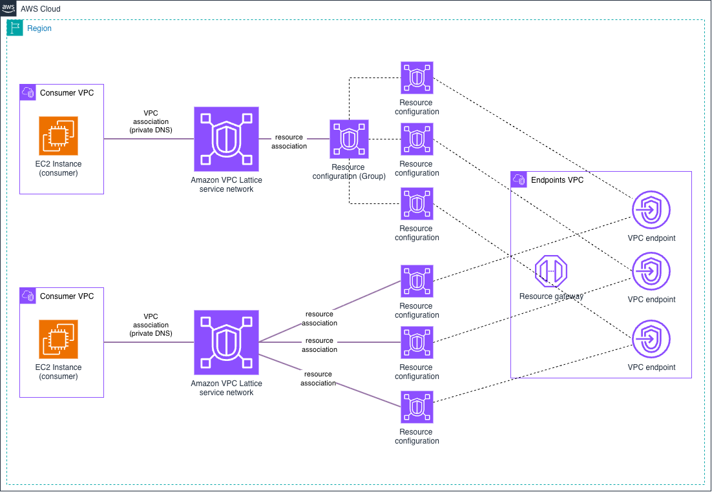

# Amazon VPC Lattice - Centralized VPC Endpoints

This pattern centralizes interface VPC endpoints in a shared **endpoints VPC** and makes them reachable from consumer VPCs through VPC Lattice **VPC Resources** (a resource gateway plus resource configurations). Instead of duplicating interface endpoints in every VPC, consumers can reach AWS services through the centralized endpoints (cutting cost and simplifying endpoint management).



Each AWS service endpoint is modeled as a resource configuration with a **custom domain name** (e.g. `ssm.<region>.amazonaws.com`). Controlled private DNS on the consumer VPC association (scoped to `*.amazonaws.com` only) makes the consumer's normal `ssm.<region>.amazonaws.com` lookup resolve to a VPC Lattice managed address (`129.224.0.x/17`) and route to the central endpoint, with no client configuration changes.

The same centralized endpoints are consumed in **two ways**, each with its own service network and consumer VPC: as **child resource configurations under one group** (consumer VPC *group*), and as **individual single resource configurations** (consumer VPC *single*). Both reach the centralized services the same way, but they differ in what happens to every *other* AWS service name. See [Two consumption models](#two-consumption-models-group-vs-single-resource-configurations).

## Why centralize, and why with VPC Lattice

**Centralize vs. decentralize is a tradeoff, not a best practice.** Interface endpoints are billed per endpoint, per AZ, so duplicating them in every VPC adds up. Centralizing them in one shared VPC cuts that cost and gives you a single place to govern and observe endpoint access. The trade-off is a cross-VPC dependency and a shared blast radius; keeping endpoints per-VPC maximizes isolation at higher cost and more management. Choose based on your cost and control priorities, not a rule.

**Why VPC Lattice instead of AWS Transit Gateway or AWS Cloud WAN** for the connectivity:

- **No NAT with overlapping CIDRs**. VPC Lattice brokers the connection, so the consumer and endpoints VPCs can share the same address space with no NAT or re-addressing.
- **Automatic DNS resolution**. Private DNS on the VPC association resolves the normal `<service>.<region>.amazonaws.com` name through VPC Lattice, with no Route 53 private hosted zones or per-consumer DNS plumbing.
- **Central logging**. Access logs on the service network and on the resource configurations record every connection, however many consumers you associate.

## What gets deployed

| Component | Details |
|-----------|---------|
| **Endpoints VPC** (`10.0.0.0/16`) | Centralized interface VPC endpoints for AWS services (SSM, SSM Messages, EC2 Messages, STS) |
| **Consumer VPCs** (`10.0.0.0/16` each) | Two consumer VPCs, *group* and *single*, each with one EC2 instance and associated to its own service network |
| **VPC Lattice service networks** | One per consumption model, connecting each consumer VPC to the centralized endpoints |
| **Resource gateway** | Dual-stack resource gateway in the endpoints VPC, shared by both consumption models |
| **Resource configurations (group)** | A group resource configuration (group domain `<region>.amazonaws.com`) plus one child configuration per endpoint, with a single association to the *group* service network |
| **Resource configurations (single)** | One single resource configuration per endpoint, each with its own association to the *single* service network |
| **Access logging** | CloudWatch Logs log groups per service network and per resource configuration type (group / single), so traffic is visible from both the service network owner and the endpoints owner |

## VPC Lattice resource configuration

This pattern uses VPC Lattice **VPC Resources** (not a service with listeners/target groups):

| Aspect | Configuration |
|--------|---------------|
| **Construct** | Resource gateway + resource configurations (group/child or single) + service network resource associations |
| **Custom Domain Name** | ✅ Yes (`<service>.<region>.amazonaws.com` per endpoint) |
| **Protocol / Port** | TCP on port 443 |
| **Private DNS** | ✅ Enabled, scoped to `*.amazonaws.com` only (`SPECIFIED_DOMAINS_ONLY`) |
| **Resolved address** | VPC Lattice VPC-resource range `129.224.0.x/17` (IPv6 `fd00:ec2:80::/64`) |
| **Targets** | Centralized interface VPC endpoints in the endpoints VPC |

## Two consumption models: group vs single resource configurations

A resource configuration carries one custom domain, and VPC Lattice manages a private hosted zone for it in each consumer VPC. How you model the endpoints decides **which domain that zone covers**, and that is the main difference between both models. The pattern deploys both side by side so you can compare them: each needs its own service network, because a VPC associates to only one service network and two resource configurations with the same custom domain can't be in the same service network.

| Aspect | Group (consumer VPC *group*) | Single (consumer VPC *single*) |
|--------|------------------------------|--------------------------------|
| **Resource configurations** | 1 group (group domain `<region>.amazonaws.com`) + 1 child per endpoint | 1 single per endpoint |
| **Service network associations** | 1 (the group covers all its children) | 1 per endpoint |
| **Private hosted zone in the consumer VPC** | `<region>.amazonaws.com` | `<service>.<region>.amazonaws.com`, one per endpoint |
| **AWS services not centralized** | Fail DNS resolution (NXDOMAIN) | Resolve as usual (public endpoint, or a local VPC endpoint) |
| **Adding an endpoint** | Add one child configuration | Add one configuration and one association |
| **Billing** | One hourly charge for the group, however many children it holds | One hourly charge per resource configuration |

> **Note**: With the group model, VPC Lattice answers for the **whole** `<region>.amazonaws.com` domain in the consumer VPC. Any AWS service under it without a child configuration (for example `ec2.<region>.amazonaws.com`, or the S3 and DynamoDB names that gateway endpoints rely on) fails DNS resolution. Exceptions need a local VPC endpoint in the consumer VPC (its more specific zone takes precedence).

**Things to take into account**

- **Group**: a good fit when consumer VPCs should reach AWS services **only** through the centralized endpoints (for example, highly regulated environments), and it scales the endpoint list at one charge. Child domains must be subdomains of the group domain, so endpoints outside it (such as dual-stack names under `*.api.aws`) need their own single configuration and association. You can also narrow the scope with a per-service group domain (e.g. `ecr.<region>.amazonaws.com` covering `ecr` and `dkr.ecr`), so nothing outside that service is affected.
- **Single**: a good fit when consumers also use AWS services you haven't centralized, as each zone covers exactly one service name. Each endpoint adds its own configuration, association and hourly charge, and any domain works (including `*.api.aws` names).
- Custom domain names can't be changed after creation, and there are quotas on resource configurations (per Region, per group, and associated per service network). Review the current values in the [VPC Lattice quotas](https://docs.aws.amazon.com/vpc-lattice/latest/ug/quotas.html) documentation before scaling the endpoint list.

## Implementation

This pattern is available for both IaC tools (CloudFormation + Terraform parity). Each implementation directory has its own README with deployment instructions:

| IaC Tool | Location |
|----------|----------|
| **CloudFormation** | [`./cloudformation/`](./cloudformation/) |
| **Terraform** | [`./terraform/`](./terraform/) |

## Testing Connectivity

After deploying, you connect to the consumer EC2 instance in each consumer VPC via Systems Manager, confirm the centralized endpoints resolve through VPC Lattice in both, and compare how each consumption model resolves an AWS service that isn't centralized — from consumer VPCs with no interface endpoints of their own.

<details>
<summary>Click to expand testing steps</summary>

#### Step 1: Connect to the Consumer Instances via Systems Manager

A successful Session Manager connection already proves the centralized endpoints work — Session Manager requires connectivity to the SSM, SSM Messages, and EC2 Messages endpoints.

> **Note**: Consumer EC2 instance IDs are provided as outputs when deploying the code (in Terraform, the `instance_ids` output is keyed `group` and `single`). Run the next steps from both instances.

```bash
aws ssm start-session --target <consumer-instance-id> --region <your-region>
```

**Expected Result**: Session Manager connects to both instances.

#### Step 2: Verify DNS Resolution for Centralized Endpoints

From the consumer instance, confirm AWS service endpoints resolve to the VPC Lattice VPC-resource range:

```bash
dig +short ssm.<your-region>.amazonaws.com
dig +short ec2messages.<your-region>.amazonaws.com
dig +short sts.<your-region>.amazonaws.com
```

**Expected Result**: in both consumer VPCs, addresses in the VPC Lattice VPC-resource range `129.224.0.x/17` (IPv6 `fd00:ec2:80::/64`), indicating VPC Lattice is handling resolution and routing.

```
129.224.0.123
129.224.0.124
```

#### Step 3: Compare Resolution of a Non-Centralized Service

Resolve an AWS service that is not in the centralized endpoint list:

```bash
dig ec2.<your-region>.amazonaws.com | grep -E 'status|^ec2'
```

**Expected Result**: the two consumption models differ.

- **Group** consumer instance: `status: NXDOMAIN`, as the VPC Lattice managed zone for `<region>.amazonaws.com` has no record for it.
- **Single** consumer instance: `status: NOERROR` with the service's public addresses, as no VPC Lattice zone covers that name. The consumer VPCs have no internet access, so this step shows DNS behavior only.

#### Step 4: Test Endpoint Connectivity

From both instances, call an AWS API to confirm traffic reaches the service through the centralized endpoint:

```bash
aws sts get-caller-identity --region <your-region>
```

**Expected Response** (JSON format):
```json
{
    "UserId": "AIDACKCEVSQ6C2EXAMPLE:i-1234567890abcdef0",
    "Account": "123456789012",
    "Arn": "arn:aws:sts::123456789012:assumed-role/ec2-ssm-role-endpoints/i-1234567890abcdef0"
}
```

</details>

## Cleanup

Tear down the resources when you are finished to stop incurring charges. While this pattern is deployed it runs consumer EC2 instances and the centralized interface VPC endpoints, and uses CloudWatch Logs vended-logs pricing for VPC Lattice access logging (ingestion + storage).

Use the teardown command for whichever implementation you deployed:

| IaC Tool | From | Command |
|----------|------|---------|
| **Terraform** | [`./terraform/`](./terraform/) | `terraform destroy` |
| **CloudFormation** | [`./cloudformation/`](./cloudformation/) | `make undeploy` |

The access-logging CloudWatch Logs log group is created and destroyed together with the pattern, so the standard teardown removes it — no manual cleanup is required.

## Next Steps

After successfully deploying this pattern:

1. **Test connectivity**: Follow the testing guide above to verify endpoints work through VPC Lattice.
2. **Add more endpoints**: Extend the `vpc_endpoints` list to centralize additional AWS services.
3. **Scale consumers**: Associate more consumer VPCs to the service network of the consumption model that fits them.
4. **Explore other patterns**: Try the [Simple Architectures](../../1-simple_architectures/) target types or [Multi-Account patterns](../../2-multi_account/).
