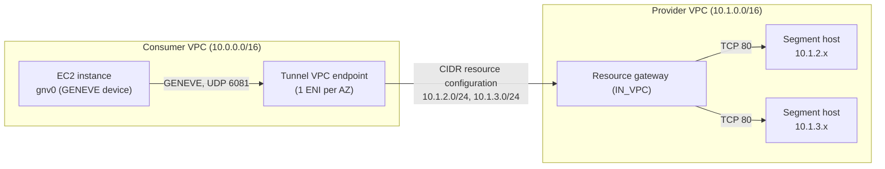
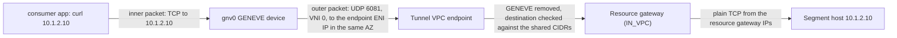

# Amazon VPC Lattice - Network Segment Access with Tunnel Endpoints

This pattern shares a whole **network segment** (a list of CIDR ranges) from a provider VPC and reaches it from a consumer VPC through a **tunnel VPC endpoint**. The provider describes the segment once, as a VPC Lattice **CIDR-type resource configuration** behind a resource gateway, instead of creating one resource configuration per resource. Any host inside the segment is reachable, which suits resources that are ephemeral or not known in advance (monitoring fleets, file distribution, vendor access to a subnet).



## How this differs from other VPC resources

Other VPC Lattice VPC resources also use a resource gateway and a resource configuration, but a CIDR-type resource configuration works very differently:

| | Single and group resource configurations | CIDR resource configuration (this pattern) |
|---|---|---|
| **What's shared** | One resource (by ARN, domain name or IP address), or a group of them | A network segment (up to 10 CIDR ranges) |
| **How the consumer connects** | Service network VPC association, or a resource / service network endpoint | Tunnel VPC endpoint only: a CIDR resource configuration can't be associated with a service network |
| **What the consumer's application uses** | A DNS name that resolves to a VPC Lattice-managed address (`129.224.0.0/17`) | The provider's real IP addresses, carried inside a GENEVE tunnel |
| **Client changes** | None | Each consumer host encapsulates traffic in GENEVE (configured in this pattern at boot by user data) |
| **Protocols** | TCP | TCP for application traffic; UDP only for DNS queries |

Choose a CIDR resource configuration when the consumer needs network-level reach into a range of addresses. When the consumer needs a few specific resources by name, single or group resource configurations are simpler and need no client-side tunnel.

## What gets deployed

| Component | Details |
|-----------|---------|
| **Provider VPC** (`10.1.0.0/16`) | Workload subnets `10.1.2.0/24` and `10.1.3.0/24` (the shared segment), with a web host in each, plus resource gateway subnets |
| **Resource gateway** | IPv4 resource gateway with DNS resolution set to `IN_VPC` (required for CIDR resource configurations, and immutable). Its security group only allows TCP 80 to the segment |
| **Resource configuration** | CIDR type, covering the two workload subnets, port 80 only |
| **Consumer VPC** (`10.0.0.0/16`) | EC2 instances (1 per AZ) that reach the segment through the tunnel endpoint, and an EC2 Instance Connect endpoint |
| **Tunnel VPC endpoint** | One ENI per AZ, in the same AZs as the resource gateway. Its security group allows UDP 6081 from the consumer instances |
| **Access logging** | A CloudWatch Logs log group (`/aws/vpclattice/<name>`, where `<name>` is the Terraform `identifier` or the CloudFormation provider stack name) and an access log subscription on the resource configuration |

> **Note**: Unlike the other patterns in this repository, the two VPCs don't overlap, because the consumer reaches the provider's real IP addresses. Overlapping VPCs also work, as long as the shared CIDR ranges don't overlap the consumer's subnets: consumer hosts send those ranges into the tunnel, so they would lose reach to the overlapping subnets (or to the tunnel endpoint itself).

## How the tunnel endpoint works

The consumer never sends application traffic to the endpoint directly. Each consumer host wraps every packet for the segment in a GENEVE header and sends it to the endpoint's own IP address. The endpoint removes the header, checks that the inner destination is inside the shared CIDR ranges, and forwards the inner packet through the resource gateway to the provider host.



- **Two layers of addressing.** The inner packet goes to the provider's real IP address. The outer GENEVE packet goes to the endpoint's network interface IP in the consumer subnet (one per AZ).
- **Encapsulation rules.** GENEVE over UDP 6081, VNI `0`, and a layer 3 IP packet inside (not an Ethernet frame). Inner application traffic must be TCP; inner UDP is accepted only for DNS.
- **Return traffic** comes back the same way, so the security groups of both the endpoint and the consumer hosts allow UDP 6081.
- **Provider hosts need no changes.** They receive ordinary TCP from the resource gateway's IP addresses, not from the consumer, so their security groups reference the resource gateway's security group.
- **What's reachable.** Only destinations inside the shared CIDR ranges, on the resource configuration's port ranges and what the resource gateway's security group allows (TCP 80 here).
- **Consumer-initiated only.** The provider VPC can't open connections to the consumer VPC.

In this pattern, the consumer instances' user data creates a kernel GENEVE device in IP mode, routes the segment through it, and keeps it up across reboots with a systemd unit:

```bash
ip link add gnv0 type geneve id 0 remote <tunnel endpoint IP in this AZ> innerprotoinherit
ip link set gnv0 mtu 8400 up
ip route replace 10.1.2.0/24 dev gnv0 src <instance IP>
ip route replace 10.1.3.0/24 dev gnv0 src <instance IP>
```

`innerprotoinherit` makes the device carry IP packets instead of Ethernet frames. The lower MTU on `gnv0` leaves room for the GENEVE and outer IP/UDP headers. Applications need no changes: `curl` to a segment address follows the route into the tunnel.

> **Production hosts**: this pattern adds the tunnel routes to the instance's main routing table to keep the example simple. In production, it's recommended to do the GENEVE encapsulation in its own routing context or network namespace, so the tunnel stays isolated from the host's other traffic.

## DNS resolution through the tunnel

> **Note**: This pattern focuses on reachability into the network segment and doesn't deploy DNS resolution through the tunnel. The consumer reaches the segment hosts by IP address.

IP addresses inside a segment change, and the provider often names its resources in a Route 53 private hosted zone or a custom resolver the consumer VPC can't see. The tunnel endpoint lets the consumer resolve those names in the provider VPC's context: the consumer sends its DNS query to `169.254.168.253`, encapsulated in GENEVE like any other packet, and the provider VPC's resolver answers it as it would for a host in that VPC.

Resolution and access are separate steps. The consumer first resolves the name (for example `app.example.com` to an internal Application Load Balancer in the segment), then connects to the returned IP address through the tunnel, where the endpoint applies its usual CIDR check. To set it up:

- **Resource configuration**: protocol `TCP_UDP` and port `53` in the port ranges, next to the application ports.
- **Consumer hosts**: a route for `169.254.168.253/32` through the GENEVE device, and a split-DNS setup that sends only the provider's domains to that address (for example a per-link DNS server on `gnv0` with systemd-resolved), so other lookups keep using the consumer VPC's resolver.

See [Access network segments through AWS PrivateLink](https://docs.aws.amazon.com/vpc/latest/privatelink/privatelink-access-cidr-ranges.html).

## Implementation

This pattern is available for both IaC tools (CloudFormation + Terraform parity). Each implementation directory has its own README with deployment instructions:

| IaC Tool | Location |
|----------|----------|
| **CloudFormation** | [`./cloudformation/`](./cloudformation/) |
| **Terraform** | [`./terraform/`](./terraform/) |

## Testing Connectivity

After deploying either implementation, connect to a consumer instance, check the GENEVE device, and reach both segment hosts by IP address.

<details>
<summary>Click to expand testing steps</summary>

#### Step 1: Connect to a Consumer Instance

> **Note**: Consumer instance IDs and segment host IPs are provided as outputs when deploying the CloudFormation or Terraform code.

```bash
aws ec2-instance-connect ssh --instance-id <consumer-instance-id> --region <your-region>
```

#### Step 2: Check the GENEVE Device

```bash
sudo systemctl status tunnel-endpoint.service --no-pager
ip -d link show gnv0
ip route | grep gnv0
```

**Expected Result**: the service is `active (exited)` and its log line shows the endpoint IP it chose. `gnv0` is a `geneve` device with `id 0` and `innerprotoinherit`, and both segment CIDRs are routed through it.

#### Step 3: Reach the Segment Hosts

```bash
curl http://<segment-host-a-ip>/
curl http://<segment-host-b-ip>/
```

**Expected Result**: each host answers with its own IP address and AZ.

```
Hello from 10.1.2.25 (eu-west-1a), reached through the shared network segment
```

</details>

## Cleanup

Tear down the resources when you are finished to stop incurring charges. While this pattern is deployed it runs EC2 instances in both VPCs and the tunnel endpoint (hourly + per GB processed), the resource gateway charges per GB processed, and access logging uses CloudWatch Logs vended-logs pricing (ingestion + storage).

Use the teardown command for whichever implementation you deployed:

| IaC Tool | From | Command |
|----------|------|---------|
| **Terraform** | [`./terraform/`](./terraform/) | `terraform destroy` |
| **CloudFormation** | [`./cloudformation/`](./cloudformation/) | `make undeploy` |

The access-logging CloudWatch Logs log group is created and destroyed together with the pattern, so the standard teardown removes it — no manual cleanup is required.

## Next Steps

After successfully deploying this pattern:

1. **Share across accounts**: This pattern deploys both sides in one account. To share the segment with another account, put the resource configuration in an AWS RAM resource share; the consumer account accepts it and creates the tunnel endpoint in subnets whose AZ IDs match the resource gateway's (AZ names can map to different physical AZs in each account).
2. **Narrow the segment**: Restrict the CIDR ranges and ports to only what the consumer needs.
3. **Explore other patterns**: Compare with the [RDS](../../1-simple_architectures/6-rds/) and [Centralized VPC Endpoints](../1-centralized_vpc_endpoints/) patterns, which share named resources through a service network.
